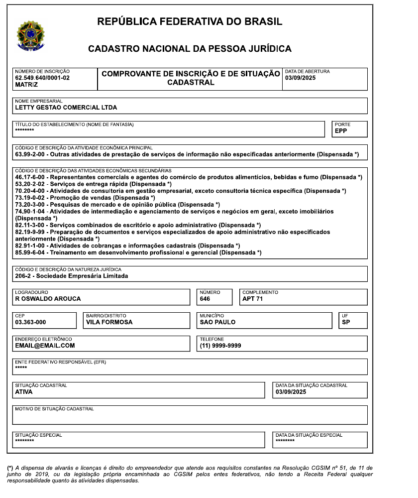
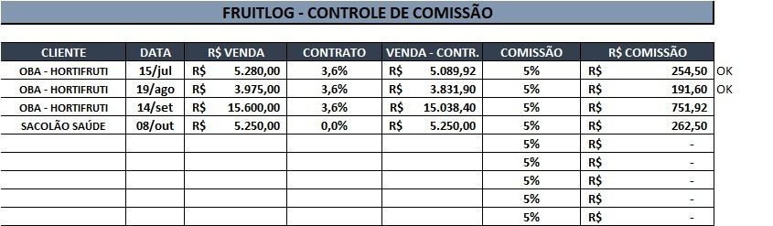
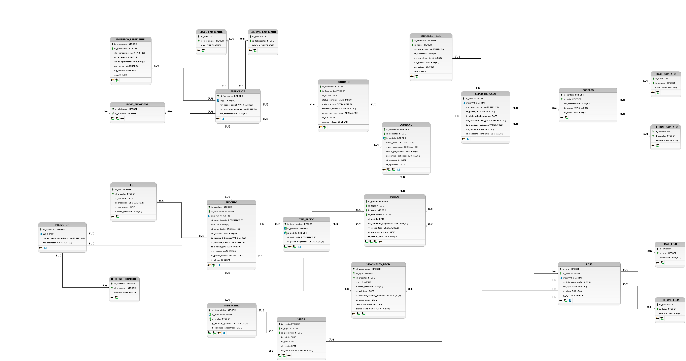

# Letty Gestão Comercial — Sistema de gestão de representação comercial

**Entrega 2 — Modelo lógico, implementação SQL e apresentação final.** Relatório técnico final do grupo, sobre a Letty Gestão Comercial Ltda (CNPJ 62.549.640/0001-02), São Paulo/SP. Para essa entrega professor, por favor considerar os commits do dia 15 de outubro em diante

## Integrantes

| Nome completo                       | RGM      | Usuário do GitHub      |
|-------------------------------------|----------|------------------------|
| Alexandre Almeida de Jesus Nogueira | 47336480 | `AlexandreNogueiraDev` |
| Khevyn Lopes dos Santos             | 46985859 | `KhevynEtec`           |
| Luis Plinio Cornelio Mota           | 47174081 | `Luis-Plinio`          |
| Marcos Paulo Cornelio Mota          | 46917462 | `m-mota`               |
| Yuri Navas Moreira                  | 47106131 | `keynavas`             |

## 1. Relatório técnico final

### 1.1 Revisão do modelo conceitual

A organização é a mesma da Entrega 1 (Caso A). A revisão partiu da correção recebida e de uma segunda visita ao responsável, em outubro.

#### A organização

A Letty Gestão Comercial Ltda é a empresa pela qual Ednilson Soares Silva atua como representante comercial autônomo de fabricantes de alimentos. Ele não compra nem revende mercadoria: vende o portfólio dos fabricantes a redes de supermercado e hortifrútis, acompanha o produto até a gôndola e recebe comissão sobre o que foi vendido. Fabricação, entrega, faturamento e cobrança ficam com o fabricante.

| Dado cadastral          | Informação                                                                  |
|-------------------------|-----------------------------------------------------------------------------|
| Razão social            | Letty Gestão Comercial Ltda                                                 |
| CNPJ                    | 62.549.640/0001-02 (matriz), situação ativa                                 |
| Abertura                | 03/09/2025                                                                  |
| Natureza jurídica       | 206-2, Sociedade Empresária Limitada, com fins lucrativos                   |
| Porte (Receita Federal) | Empresa de Pequeno Porte                                                    |
| Atividade               | Representação comercial de produtos alimentícios (CNAE 46.17-6-00, atividade secundária no CNPJ; a principal registrada é 63.99-2-00) |
| Endereço                | Rua Oswaldo Arouca, 646, apto 71, Vila Formosa, São Paulo/SP, CEP 03363-000 |

Hoje são três fabricantes representados:

| Fabricante                                      | Linha                                                                     | CNPJ               |
|-------------------------------------------------|---------------------------------------------------------------------------|--------------------|
| FruitLog                                        | Água gaseificada importada da Argentina, em fardos (cerca de 10 produtos) | 00.719.594/0001-95 |
| Queijos Gran Mestri (Gran Mestri Alimentos S/A) | Queijos e laticínios                                                      | 05.071.877/0001-97 |
| Bananinha Paraibuna                             | Doces de banana                                                           | 03.535.509/0001-27 |

Os clientes são o Oba Hortifruti e o Sacolão Saúde. O Oba tem matriz e centro de distribuição em Campinas e 55 lojas atendidas, cada uma com CNPJ, número e código interno próprios: 22 na capital e Grande São Paulo, 11 em Campinas, 9 no interior paulista, 11 em Brasília e 2 em Goiânia. O Sacolão Saúde tem uma loja só. É essa estrutura — a rede negocia, a loja recebe — que leva o modelo a separar `super_mercado` de `loja`.

#### Porte

Ednilson trabalha sozinho. Não quis informar o volume total de vendas, então os números de venda abaixo saem da planilha de comissões da FruitLog, que ele mostrou na segunda visita.

| Indicador                          | Valor                                                                 | Fonte                |
|------------------------------------|-----------------------------------------------------------------------|----------------------|
| Clientes (redes)                   | 2: Oba Hortifruti e Sacolão Saúde                                     | Planilha             |
| Catálogo da FruitLog               | Cerca de 10 produtos, vendidos em fardos                              | Entrevista           |
| Pedidos da FruitLog, jul–out/2026  | 4                                                                     | Planilha             |
| Valor vendido no período           | R\$ 30.105,00 bruto; R\$ 29.210,22 após o desconto contratual         | Planilha             |
| Valor por pedido                   | Média de R\$ 7.526,25; de R\$ 3.975,00 a R\$ 15.600,00                | Planilha             |
| Comissões no período               | R\$ 1.460,52, dos quais R\$ 446,10 recebidos e R\$ 1.014,42 pendentes | Planilha             |
| Percentual de comissão             | 1% a 5%, conforme o valor agregado; 5% na FruitLog                    | Entrevista, planilha |
| Prazo de pagamento dos clientes    | 7 dias no mercado de esquina; até 60 dias nas grandes contas          | Entrevista           |
| Frequência de visita às lojas      | 7 dias (iogurte), 20 dias (água), no máximo 30 dias para o resto      | Entrevista           |
| Promotores por loja                | Em geral 1; até 3 nas lojas grandes                                   | Entrevista           |
| Aviso desejado antes do vencimento | 10 dias                                                               | Entrevista           |

Esses números definem o tamanho da massa de dados (seção 4). Como o representante não autorizou o uso de pedidos nem de notas reais, a massa é fictícia e segue esses volumes.

#### Problemas

As informações estão espalhadas: uma planilha por fabricante, os portais das redes, relatórios do promotor e anotações. O pedido do representante foi “ter tudo num lugar só”. Cada problema abaixo tem tabela no modelo e consulta no script (rastreabilidade na seção 1.6).

|     | Problema                                                                                                                                            | Resposta do modelo                                                                                                      | Consultas     |
|-----|-----------------------------------------------------------------------------------------------------------------------------------------------------|-------------------------------------------------------------------------------------------------------------------------|---------------|
| P1  | **Perda por vencimento no ponto de venda.** Não há controle de lote e validade na gôndola; o vencimento é descoberto tarde e vira prejuízo.         | `lote`; `item_visita`, com quantidade e menor validade encontradas; `vencimento_prod`, com a ocorrência e sua situação. | G01, G02, G06 |
| P2  | **Promotoria sem controle.** O trabalho depende de promotores terceirizados, e não se sabe quem visitou cada loja, quando, nem por quanto tempo.    | `promotor`; `envia_promotor`, que liga o promotor aos fabricantes; `visita`, com data e horários.                                | G03, A04, A08 |
| P3  | **Pedidos e entregas sem rastro.** A venda é anotada só pelo total, o cliente é um nome digitado e a situação do pedido fica nos portais das redes. | `super_mercado` e `loja`, com CNPJ único; `pedido`, com situação e entrega prevista; `item_pedido`.                     | G04, G07      |
| P4  | **Contratos e comissões sem registro.** O pagamento da comissão é marcado com um “OK” sem data, e o percentual é redigitado em cada linha.          | `contrato`, com vigência, percentual e meta; `comissao`, uma por pedido, com base, percentual aplicado, situação e data de pagamento. | G05, G08      |

#### Escopo

O banco cobre a operação de representação de ponta a ponta: fabricantes, com endereço, telefones e e-mails; contratos e comissões; produtos e lotes; redes, lojas e contatos por setor; promotores e seus fabricantes; pedidos e itens; visitas e conferência de gôndola; ocorrências de vencidos. Ficam de fora os controles do fabricante e de terceiros — fabricação, estoque da fábrica, entrega, faturamento, cobrança e folha dos promotores — e os processos listados, com o motivo, ao fim de *Processos de negócio*.

#### Por que a Letty

O representante não tem sistema próprio, e a falta dele é concreta: não há como dizer o que foi vendido, de qual fabricante, para qual loja, nem se a comissão já entrou. Para o projeto, o caso oferece entidades bem ligadas entre si, três relacionamentos N:N (pedido × produto, visita × produto, fabricante × promotor) e uma regra de cálculo verificável, a da comissão.

> **Vínculo.** O entrevistado, Ednilson Soares Silva, é sogro do integrante Yuri Navas Moreira. As entrevistas aconteceram no local de trabalho do responsável, e a Figura 3 registra a segunda.

#### Evidências

A Letty não tem perfil no Google Meu Negócio, site nem redes sociais. Representante autônomo não atende público nem mantém ponto comercial; o cliente é conquistado em contato direto com o comprador. A existência da empresa e o acesso do grupo estão comprovados por:

- comprovante de inscrição no CNPJ, com situação ativa (Figura 1);
- endereço completo, indicado acima;
- planilha de comissões mostrada pelo representante (Figura 2) e relação das lojas do cliente principal enviada por ele;
- foto da entrevista no local (Figura 3);
- nome e telefone do responsável, abaixo.

***Figura 1** — Comprovante de inscrição e de situação cadastral no CNPJ. Arquivo `evidencias/cnpj_letty.png`.*

#### Responsável

|          |                                                                                      |
|----------|--------------------------------------------------------------------------------------|
| Nome     | Ednilson Soares Silva                                                                |
| Função   | Representante comercial autônomo e responsável pela Letty Gestão Comercial Ltda      |
| Telefone | +55 11 99272-9025 — o responsável pede que o professor mande mensagem antes de ligar |

#### Entrevistas

Foram dois encontros presenciais no escritório da Letty, os dois conduzidos por Yuri Navas Moreira, e um contato posterior por WhatsApp para confirmar fabricantes e produtos.

|               | Primeira entrevista                                                                                                                | Segunda entrevista                                                                                                     |
|---------------|------------------------------------------------------------------------------------------------------------------------------------|------------------------------------------------------------------------------------------------------------------------|
| Data          | 13/09/2026                                                                                                                         | 17/10/2026, à tarde                                                                                                    |
| Local         | Rua Oswaldo Arouca, 646, apto 71, Vila Formosa, São Paulo/SP — endereço do CNPJ, onde o representante organiza pedidos e planilhas |                                                                                                                        |
| Participantes | Ednilson Soares Silva (entrevistado) e Yuri Navas Moreira                                                                          |                                                                                                                        |
| Roteiro       | 70 perguntas em 9 blocos, mais 20 sobre o processo de venda                                                                        | 25 perguntas em 8 blocos: comissão, trocas, contrato, pedidos, visitas, promotores, financeiro e cardinalidades do DER |
| Serviu para   | Entrega 1                                                                                                                          | Confirmar processos, regras e volumes e observar como o controle é feito                                               |

##### O que foi respondido

- **Venda.** Não termina no pedido: começa na captação, passa pelo cadastro do produto na rede (comercial, cadastro, fiscal, pricing, produtos, logística), pela negociação em reunião periódica, pela entrega do fabricante e pela reposição do promotor, e segue no acompanhamento loja a loja.
- **Comissão.** De 1% a 5%, conforme o valor agregado. É paga na liquidação do título ou quando o pedido entra no sistema do fabricante, cai por crédito em conta contra nota fiscal do representante e se perde se o pedido for cancelado.
- **Contrato.** Sem exclusividade de região — cada representante é designado para redes específicas —, com renovação automática anual e adendo quando alguma condição muda.
- **Pedido.** Não há valor mínimo fixo; depende do porte do mercado. O prazo vai de 7 a 60 dias, e o pagamento é por boleto ou transferência. O pedido costuma ser centralizado: um pedido para nove lojas, por exemplo.
- **Visitas e validade.** A frequência acompanha o giro, de 7 a 30 dias. O ideal é ser avisado 10 dias antes do vencimento; a regra é tirar o produto da gôndola 5 dias antes.
- **Promotores.** Contratados pelo fabricante (CLT ou PJ) ou por agência, fixos ou de rota. Em geral um por loja, até três nas grandes.
- **Cardinalidades.** Cada loja pertence a uma rede; cada lote é de um produto, com uma validade; há contatos na central da rede.

##### O que foi observado

Na segunda visita, Yuri pediu para ver como as vendas e as comissões são controladas. A única ferramenta mostrada foi a planilha “FruitLog – Controle de Comissão” (Figura 2). Com autorização, o grupo fotografou a tela, transcreveu os dados (Tabela 1) e refez as contas. Os achados O1 a O10 vêm do que foi visto, não do que foi dito.

***Figura 2** — Planilha de controle de comissões da FruitLog. Arquivo `evidencias/planilha_fruitlog.jpg`.*

| Cliente          | Data   | Venda (R\$) | Contrato | Venda − contrato (R\$) | Comissão | Comissão (R\$) | Marca |
|------------------|--------|-------------|----------|------------------------|----------|----------------|-------|
| OBA - HORTIFRUTI | 15/jul | 5.280,00    | 3,6%     | 5.089,92               | 5%       | 254,50         | OK    |
| OBA - HORTIFRUTI | 19/ago | 3.975,00    | 3,6%     | 3.831,90               | 5%       | 191,60         | OK    |
| OBA - HORTIFRUTI | 14/set | 15.600,00   | 3,6%     | 15.038,40              | 5%       | 751,92         |       |
| SACOLÃO SAÚDE    | 08/out | 5.250,00    | 0,0%     | 5.250,00               | 5%       | 262,50         |       |

Tabela 1 — Transcrição da planilha (datas de 2026). Todas as linhas fecham com comissão = venda × (1 − % contrato) × % comissão.

|     | Visto na planilha                                                                                                                                                 | Consequência                                                | Resposta do modelo                                                   | Prob.  |
|-----|-------------------------------------------------------------------------------------------------------------------------------------------------------------------|-------------------------------------------------------------|----------------------------------------------------------------------|--------|
| O1  | Uma planilha por fabricante, sendo três os representados.                                                                                                         | Não há visão única de vendas e comissões.                   | `fabricante`, `pedido` e `comissao` no mesmo banco.                  | P3, P4 |
| O2  | Venda registrada só pelo total, sem itens, número do pedido ou entrega. Na entrevista, ele disse anotar tudo isso — foi a maior distância entre o dito e o visto. | Não se sabe o que foi vendido nem se foi entregue.          | `item_pedido`; `pedido.dt_prevista_entrega`.                         | P3     |
| O3  | Cliente como texto livre (“OBA - HORTIFRUTI”), sem CNPJ, loja ou contato.                                                                                         | Um mesmo cliente pode virar dois; a loja da venda se perde. | `super_mercado`, `loja` e `contato`, com CNPJ único (RN02).          | P3     |
| O4  | Datas sem ano (“15/jul”).                                                                                                                                         | Impossível comparar períodos.                               | Colunas `DATE` em pedido e comissão.                                 | P3, P4 |
| O5  | Percentuais redigitados em cada linha.                                                                                                                            | Risco de percentual errado.                                 | `contrato.percentual_comissao` e `comissao.percentual_aplicado`.     | P4     |
| O6  | Pagamento marcado com “OK”, sem data. Duas comissões estavam pendentes havia 33 e 9 dias.                                                                         | Não dá para saber se há atraso.                             | `comissao.status_pagamento` e `dt_pagamento`.                        | P4     |
| O7  | Nenhum registro de visita, validade ou vencido. Segundo ele, isso fica nos relatórios do promotor e da rede.                                                      | O processo existe, mas o dado não fica guardado.            | `visita`, `item_visita` e `vencimento_prod`.                         | P1, P2 |
| O8  | A comissão incide sobre o valor já descontado do contrato — regra que não apareceu na entrevista.                                                                 | É uma regra de cálculo que o sistema precisa seguir.        | `super_mercado.pc_desconto_contratual` guarda o desconto de cada rede; `comissao.valor_base`, a base líquida (RN10). | P4     |
| O9  | Pedido e comissão na mesma linha, sem coluna de situação.                                                                                                         | Cancelar ou cortar exige apagar ou reescrever a linha.      | Situações separadas em `pedido` e `comissao`; nada é apagado (RO02). | P3, P4 |
| O10 | Feita a conta, o Oba tem 3 dos 4 pedidos e 82,6% do valor bruto.                                                                                                  | A dependência de um cliente só aparece fora da planilha.    | Consultas por rede (G04, G07) e por fabricante (G05, G08).           | P3, P4 |

***Figura 3** — Ednilson Soares Silva (à esquerda) e Yuri Navas Moreira na segunda visita, em 17/10/2026. Arquivo `evidencias/foto_entrevista.jpg`.*

##### O que mudou desde a Entrega 1

- **Equipe e idade da empresa.** A E1 registrou duas pessoas e um ano e meio de atividade. O representante trabalha sozinho, e o CNPJ foi aberto em 03/09/2025.
- **Fabricantes e volume.** As “duas empresas” sem nome viraram três fabricantes identificados. O volume da E1, de 15 a 30 pedidos por semana, foi substituído pelo da planilha: 4 pedidos e R\$ 30.105,00 de julho a outubro.
- **Regras.** Entraram a perda da comissão no cancelamento, a base líquida, a renovação anual sem exclusividade, a periodicidade de visita e a antecedência do aviso (RN08 a RN15).

O levantamento completo está em `levantamento/levantamento.md`.

#### Processos, requisitos e regras

##### Processos de negócio

| Processo                       | Como funciona e que dados registra                                                                                                                                                                                                                                                                                                                                                                                             | Prob. |
|--------------------------------|--------------------------------------------------------------------------------------------------------------------------------------------------------------------------------------------------------------------------------------------------------------------------------------------------------------------------------------------------------------------------------------------------------------------------------|-------|
| PR01 · Fabricantes e contratos | Ao assumir um fabricante, o representante cadastra razão social, nome fantasia, CNPJ, inscrição estadual, endereço (logradouro, número, complemento, bairro, UF, CEP), telefones e e-mails — estes opcionais, porque a FruitLog não informou contato. O contrato traz início, fim, situação, percentual de comissão, meta de vendas, território e exclusividade. A renovação anual encerra o contrato anterior e abre um novo. | P4    |
| PR02 · Apuração de comissões   | Cada pedido entregue gera uma comissão, apurada no fim do mês, ligada ao pedido e ao contrato em vigor: data de apuração, valor base (já sem o desconto contratual), percentual aplicado, valor, situação (*Pendente*, *Aprovado*, *Pago* ou *Cancelado*) e data de pagamento.                                                                                                                                                                                 | P4    |
| PR03 · Redes, lojas e contatos | Rede: CNPJ, razão social, nome fantasia, inscrição estadual, representante geral, portal de fornecedores, início do relacionamento, desconto contratual e endereço. Loja: CNPJ, código na rede, nome, tipo, situação, telefones e e-mails de recebimento; o centro de distribuição entra como loja da rede, do tipo *CD*. Contato: nome, cargo, setor, telefones e e-mails.                                                                                             | P3    |
| PR04 · Produtos e lotes        | Produto: EAN, NCM, descrição, marca, embalagem, unidade, pesos bruto e líquido, regime tributário, preço de tabela e se está ativo. Lote: número, fabricação, validade e quantidade produzida.                                                                                                                                                                                                                                 | P1    |
| PR05 · Pedidos                 | O pedido sai da reunião com o comprador. Registra loja de entrega (o CD, no pedido centralizado), rede, fabricante, data, condição de pagamento, total, entrega prevista e situação: *Negociação*, *Registrado*, *Aprovado*, *Faturado*, *Em Transporte*, *Entregue*, *Entregue Parcialmente*, *Recusado/Cortado* ou *Cancelado*. Cada item tem produto, quantidade e preço negociado.                                         | P3    |
| PR06 · Promotoria e visitas    | Promotor: CPF, nome, empresa contratante, telefones e fabricantes que atende. Visita: loja, promotor, data, horários de início e fim e observação, a cada 7 a 30 dias conforme o giro.                                                                                                                                                                                                                                         | P2    |
| PR07 · Conferência de gôndola  | Para cada produto conferido na visita: quantidade em gôndola (zero é ruptura) e menor validade encontrada.                                                                                                                                                                                                                                                                                                                     | P1    |
| PR08 · Vencidos                | Produto vencido ou avariado: loja, produto, CNPJ da loja, número do lote, validade, quantidade, data, descrição e situação (*Identificado*, *Notificado*, *Descartado*). Troca e ressarcimento ficam com a indústria.                                                                                                                                                                                                          | P1    |

###### Processos comuns no ramo

O grupo levantou, com apoio de IA (seção 6), o que empresas de representação de alimentos costumam controlar, e conferiu com o representante o que existe na Letty.

|       | Processo                                                   | Na Letty   | Decisão                                                                                                                       |
|-------|------------------------------------------------------------|------------|-------------------------------------------------------------------------------------------------------------------------------|
| PCR01 | Estoque próprio e compras                                  | Não existe | A Letty não tem estoque nem compra mercadoria. O que se registra é a quantidade encontrada na gôndola (PR07).                 |
| PCR02 | Nota fiscal, logística e cobrança                          | Terceiros  | São do fabricante. O banco guarda a situação do pedido e a entrega prevista (PR05).                                           |
| PCR03 | Folha e escala dos promotores                              | Terceiros  | São do fabricante ou da agência. O banco guarda o vínculo e as visitas (PR06).                                                |
| PCR04 | Cancelamento de pedido                                     | Existe     | É a situação *Cancelado* do pedido, que permanece no histórico (PR05, RO02).                                                  |
| PCR05 | Histórico de situações do pedido                           | Parcial    | Guarda-se a situação atual; o histórico com data e hora fica como evolução (seção 1.5).                                       |
| PCR06 | Devolução e troca                                          | Terceiros  | Acertadas entre loja e indústria. O banco registra a ocorrência (PR08).                                                       |
| PCR07 | Pesquisa de preço, ações promocionais e previsão de vendas | Informal   | Citadas na entrevista, sem registro hoje (O7). Ficam fora desta versão, que se concentra em P1 a P4, e entram como evolução.  |
| PCR08 | Despesas do representante                                  | Existe     | Combustível, CORE-SP e impostos ficam na contabilidade. O banco cobre a receita, que é a comissão (PR02). Fica como evolução. |

##### Requisitos funcionais

|      | Requisito                                                                                                                                                                                                                                                                                               | Prob.  |
|------|---------------------------------------------------------------------------------------------------------------------------------------------------------------------------------------------------------------------------------------------------------------------------------------------------------|--------|
| RF01 | Cadastrar fabricantes e redes com razão social, nome fantasia, CNPJ único, inscrição estadual e endereço (logradouro, número, complemento, bairro, UF, CEP); redes com desconto contratual; lojas com CNPJ, código na rede, nome, tipo (loja ou CD) e situação; telefones de fabricante, loja, contato e promotor; e-mails de fabricante, loja e contato. | P3     |
| RF02 | Registrar contratos (fabricante, início, fim, situação, percentual, meta, território, exclusividade) e comissões, uma por pedido (valor base, percentual aplicado, valor, situação, datas de apuração e de pagamento).                                                                                                  | P4     |
| RF03 | Manter produtos com EAN único, NCM, descrição, marca, embalagem, unidade, pesos, regime tributário, preço de tabela e situação, e seus lotes (número, fabricação, validade, quantidade).                                                                                                                | P1     |
| RF04 | Registrar pedidos com loja, rede, fabricante, data, condição de pagamento, total, entrega prevista e situação, e itens com produto, quantidade e preço negociado.                                                                                                                                       | P3     |
| RF05 | Registrar visitas com data, horários e observação, e os produtos conferidos com quantidade em gôndola e menor validade.                                                                                                                                                                                 | P1, P2 |
| RF06 | Registrar ocorrências de vencido ou avaria com loja, produto, CNPJ da loja, lote, validade, quantidade, data, descrição e situação.                                                                                                                                                                     | P1     |
| RF07 | Cadastrar promotores (CPF único, nome, empresa contratante, telefones), ligá-los aos fabricantes e cadastrar contatos das redes (nome, cargo, setor, telefones, e-mails).                                                                                                                               | P2     |
| RF08 | Listar os produtos conferidos que vencem em até 30 dias, marcando como urgentes os de até 10, e somar as perdas por loja e mês.                                                                                                                                                                         | P1     |
| RF09 | Listar a situação dos pedidos por rede, loja e fabricante, apontar os atrasados em relação à entrega prevista e calcular a distribuição por situação.                                                                                                                                                   | P3     |
| RF10 | Listar comissões por fabricante e situação de pagamento, e lojas ativas sem visita no prazo.                                                                                                                                                                                                            | P2, P4 |

##### Requisitos não funcionais

|       | Requisito                                                                                                                                                                     |
|-------|-------------------------------------------------------------------------------------------------------------------------------------------------------------------------------|
| RNF01 | MySQL 8 com InnoDB e `utf8mb4_unicode_ci`: transações ACID, integridade referencial e acentuação correta.                                                                     |
| RNF02 | Dados pessoais de promotores e contatos (CPF, telefone, e-mail) limitados ao necessário, com acesso restrito, guarda de 5 anos e anonimização depois (LGPD, Lei 13.709/2018). |
| RNF03 | Consultas gerenciais e de auditoria em menos de 2 segundos com a massa de teste, apoiadas nos índices de CNPJ, CPF, EAN e das chaves estrangeiras.                            |
| RNF04 | Pedidos, visitas e ocorrências de vencido nunca são excluídos.                                                                                                                |
| RNF05 | Um único usuário, o representante, que cadastra, altera e exclui. Não há perfis.                                                                                              |

**Fora do escopo.** Emissão de nota de venda (é do fabricante); integração com os portais das redes (sistemas de terceiros); aplicativo do promotor e roteirização por GPS (não foram pedidos e não cabem numa operação de uma pessoa); perfis de acesso (há um usuário só).

##### Regras de negócio

RN01 a RN06, RO01 e RO02 vêm da Entrega 1. RN07 a RN15 foram levantadas agora, com apoio de pesquisa em IA, e conferidas na entrevista.

|      | Regra                                                                                                    | Implementação                              |
|------|----------------------------------------------------------------------------------------------------------|--------------------------------------------|
| RN01 | Não há pedido para loja, fabricante ou produto não cadastrado.                                           | FKs de `pedido` e `item_pedido`; A09       |
| RN02 | CNPJ (fabricante, rede, loja), CPF (promotor) e EAN (produto) são obrigatórios e únicos.                 | `UNIQUE`, `NOT NULL`                       |
| RN03 | Todo pedido tem pelo menos um item.                                                                      | A01                                        |
| RN04 | O preço negociado não fica abaixo do preço de tabela.                                                    | `CHECK` de valor ≥ 0; A03                  |
| RN05 | Produto vencido não é vendido nem reposto; a ocorrência fica aberta até o descarte.                      | A05                                        |
| RN06 | Cada loja tem suas regras de recebimento (janela de horário, documentos).                                | Processo operacional, não armazenado (1.5) |
| RN07 | A validade do lote é posterior à fabricação.                                                             | A02                                        |
| RN08 | Comissão só é devida sobre pedido entregue; pedido cancelado gera comissão *Cancelado*.                  | `comissao.id_pedido`; A10                  |
| RN09 | Produto conferido com validade em até 30 dias entra em alerta; em até 10, é urgente.                     | G01                                        |
| RN10 | `valor_comissao = valor_base × percentual_aplicado ÷ 100`, com base líquida do desconto contratual.      | `pc_desconto_contratual`; `CHECK`; A10     |
| RN11 | Toda loja ativa (exceto o CD) é visitada pelo menos a cada 30 dias.                                      | A04, A08                                   |
| RN12 | Não há pedido mínimo fixo: ele acompanha o porte do mercado. A condição de pagamento fica no pedido.     | `pedido.ds_condicao_pagamento`             |
| RN13 | Vencido ou avariado é registrado, comunicado à indústria e só se encerra como *Descartado*.              | `CHECK` de situação; A05                   |
| RN14 | O contrato (Lei 4.886/1965) fixa vigência, território e percentual; na Letty, sem exclusividade de zona. | `contrato`, `CHECK` de vigência            |
| RN15 | Dados pessoais seguem a LGPD: acesso restrito, guarda de 5 anos e anonimização.                          | RNF02; dicionário                          |
| RO01 | A entrada na rede segue a ordem comercial → cadastro → fiscal → pricing → produtos → logística.          | `contato.ds_setor`                         |
| RO02 | Pedidos, visitas e ocorrências de vencido não são apagados.                                              | `ON DELETE RESTRICT`                       |

**Fora do escopo.** Limite de crédito do cliente, porque quem fatura é o fabricante; controle de acesso por cargo, porque há um usuário só.

#### DER conceitual e Caso A

O DER revisado foi feito no **brModelo 3.2** e está em `diagramas/DER_Conceitual_Revisado.png`. Segue a notação pedida: entidades em retângulo, com atributos listados e identificador sublinhado; relacionamentos em losango, com `(mín, máx)` dos dois lados; atributos multivalorados em círculo vazio com a cardinalidade; relacionamentos N:N com atributos próprios ligados ao losango (compõe e verifica). O DER não mostra chaves estrangeiras.

> **Como ler as cardinalidades.** O par ao lado de uma entidade diz com quantas instâncias dela cada instância da outra se relaciona. Em *SUPER_MERCADO (1,1) — possui — (1,n) LOJA*, cada loja pertence a uma rede, e cada rede tem uma ou mais lojas.

##### Correções da Entrega 1

A Entrega 1 recebeu 1,15 de 1,60. Cada apontamento e o que foi feito:

| Apontamento                                                                                               | O que mudou                                                                                                                                                             | Por quê                                                                                     |
|-----------------------------------------------------------------------------------------------------------|-------------------------------------------------------------------------------------------------------------------------------------------------------------------------|---------------------------------------------------------------------------------------------|
| Processos com 69% de cobertura; faltavam comissões, vencidos, promotores e contrato                       | Entraram PR01 (contratos), PR02 (comissões), PR06 (promotores e fabricantes) e PR08 (vencidos). O que ficou de fora tem motivo registrado.                              | O banco precisa cobrir a operação inteira, não só a venda.                                  |
| Regras com 61% de cobertura; faltavam comissão, vencidos, visitas, alerta, pedido mínimo, contrato e LGPD | RN08 e RN10 (comissão), RN09 (alerta), RN11 (visitas), RN12 (pedido mínimo), RN13 (vencidos), RN14 (contrato) e RN15 (LGPD), com valores confirmados na segunda visita. | São essas regras que as auditorias A01 a A08 verificam.                                     |
| Todas as cardinalidades iguais, (1,n)–(1,n)                                                               | Revistas uma a uma e confirmadas no último bloco da entrevista.                                                                                                         | Cardinalidade única não descreve a operação e gera FKs erradas.                             |
| N:N produto–pedido sem quantidade e preço; N:N produto–visita sem atributos; dados de gôndola em VISITA   | Os relacionamentos compõe (pedido × produto) e verifica (visita × produto) ganharam quantidade, preço negociado, quantidade em gôndola e validade encontrada, que saíram de VISITA. No lógico viram item_pedido e item_visita.                                                           | Sem elas não se sabe o que foi vendido nem o que estava na gôndola.                         |
| Entidades sugeridas: ITEM, COMISSÃO e histórico de status                                                 | COMISSAO criada. O item foi modelado como atributos dos relacionamentos N:N, que no lógico viram as tabelas item_pedido e item_visita. O histórico de status não entrou.                           | Item e comissão resolvem P3 e P4. As consultas desta versão usam só a situação atual (1.5). |
| DER e dicionário divergentes: cardinalidades, nomes de telefone e e-mail, NCM                             | O dicionário passou a ser gerado do `script_completo.sql`, com os nomes do modelo lógico.                                                                                        | Uma fonte só elimina a divergência.                                                         |
| Dicionário só com a cardinalidade máxima, sem associativas                                                | Relacionamentos com mínima e máxima e seção de relacionamentos N:N com atributos.                                                                                       | A mínima define se a FK é obrigatória.                                                      |
| Notação do dicionário inconsistente                                                                       | Expressão, leitura e tabela saem da mesma estrutura.                                                                                                                    | Evita que uma contradiga a outra.                                                           |
| Prefixos misturados (`DS_` e `CD_INSCRICAO_ESTADUAL`)                                                     | Padronizado `ds_inscricao_estadual`.                                                                                                                                    | Mesmo dado, mesmo nome.                                                                     |
| LGPD sem política de guarda                                                                               | Guarda de 5 anos e anonimização (RNF02, RN15).                                                                                                                          | A lei exige finalidade e prazo.                                                             |
| Cardinalidades sem justificativa                                                                          | Tabela própria na seção 1.5.                                                                                                                                            | Foi o que a correção pediu.                                                                 |
| Entrevista citada só como “entrevista técnica”; foto fora do repositório                                  | Relato das duas entrevistas, achados da observação e foto em JPG no repositório.                                                                                        | O esqueleto exige entrevista presencial comprovada no repositório.                          |
| E-mail pessoal do responsável exposto                                                                     | Removido. Ficaram nome e telefone, com o aviso pedido por ele.                                                                                                          | Privacidade; o esqueleto pede só nome e telefone.                                           |
| Arquivos citados fora do repositório                                                                      | Citações retiradas; o levantamento está em `levantamento/levantamento.md`.                                                                                              | Só conta o que está no repositório.                                                         |

### 1.2 Conversão para o modelo lógico

O modelo lógico tem 24 tabelas: 12 vêm de entidades, 3 de relacionamentos N:N e 9 de atributos multivalorados.

#### Entidades

Cada entidade virou tabela com chave primária substituta `INT AUTO_INCREMENT`: `fabricante`, `super_mercado`, `loja`, `contato`, `promotor`, `produto`, `lote`, `contrato`, `comissao`, `pedido`, `visita` e `vencimento_prod`. O identificador natural do DER — CNPJ, CPF ou EAN — virou coluna `UNIQUE NOT NULL`.

#### Atributos

| Atributo                                   | Conversão                                               | Exemplo                                          |
|--------------------------------------------|---------------------------------------------------------|--------------------------------------------------|
| Texto                                      | `VARCHAR(n)`, com o tamanho do dicionário               | `nm_razao_social VARCHAR(120)`                   |
| CNPJ, CPF, CEP, NCM                        | Texto de tamanho fixo, para não perder zeros à esquerda | `cpf CHAR(11)`                                   |
| Dinheiro                                   | `DECIMAL(10,2)`; meta de vendas em `DECIMAL(12,2)`      | `vl_preco_tabela`                                |
| Peso e quantidade                          | `DECIMAL(10,3)` e `DECIMAL(10,2)`                       | `qt_peso_liquido`                                |
| Sim/não                                    | `BOOLEAN`                                               | `in_ativa`                                       |
| Data e hora                                | `DATE` e `TIME`                                         | `dt_visita`, `hr_inicio`                         |
| Composto (endereço)                        | Uma coluna por parte                                    | logradouro, número, complemento, bairro, UF, CEP |
| Multivalorado (telefone, e-mail, endereço) | Tabela própria, uma linha por valor, com FK para o dono | `telefone_loja`, `endereco_rede`                 |

#### Relacionamentos

Em **1:N**, a chave do lado 1 vai como FK para o lado N; a mínima 1 do lado 1 torna a FK `NOT NULL`.

| Relacionamento                    | Chave estrangeira                                    | Cardinalidade |
|-----------------------------------|------------------------------------------------------|---------------|
| Fabricante firma contrato         | `contrato.id_fabricante`                             | (1,1)–(1,n)   |
| Contrato gera comissão            | `comissao.id_contrato`                               | (1,1)–(0,n)   |
| Pedido gera comissão              | `comissao.id_pedido` (`UNIQUE`)                      | (1,1)–(0,1)   |
| Fabricante fabrica produto        | `produto.id_fabricante`                              | (1,1)–(0,n)   |
| Produto possui lote               | `lote.id_produto`                                    | (1,1)–(0,n)   |
| Rede possui loja                  | `loja.id_rede`                                       | (1,1)–(1,n)   |
| Rede tem contato                  | `contato.id_rede`                                    | (1,1)–(0,n)   |
| Fabricante, rede e loja no pedido | `pedido.id_fabricante`, `id_rede`, `id_loja`         | (1,1)–(0,n)   |
| Loja e promotor na visita         | `visita.id_loja`, `id_promotor`                      | (1,1)–(0,n)   |
| Loja e produto no vencimento      | `vencimento_prod.id_loja`, `id_produto`              | (1,1)–(0,n)   |
| Multivalorados                    | `id_*` em cada `endereco_*`, `telefone_*`, `email_*` | (1,1)–(0,n)   |

Em **N:N**, o relacionamento vira tabela associativa com as chaves dos dois lados:

- `item_pedido` (pedido × produto): chave própria, `UNIQUE (id_pedido, id_produto)`, quantidade e preço negociado.
- `item_visita` (visita × produto): chave própria, `UNIQUE (id_visita, id_produto)`, quantidade em gôndola e validade encontrada.
- `envia_promotor` (fabricante × promotor): chave composta `(id_fabricante, id_promotor)`, sem outros atributos.

Não há relacionamento 1:1 nem generalização no DER, então nenhuma estratégia de especialização foi necessária.

### 1.3 Chaves primárias e estrangeiras

<table>
<colgroup>
<col style="width: 33%" />
<col style="width: 33%" />
<col style="width: 33%" />
</colgroup>
<thead>
<tr class="header">
<th style="width: 24%">Tabela</th>
<th style="width: 30%">Chave primária</th>
<th>Chaves estrangeiras</th>
</tr>
</thead>
<tbody>
<tr class="odd">
<td><code>super_mercado</code></td>
<td><code>id_rede</code></td>
<td>—</td>
</tr>
<tr class="even">
<td><code>fabricante</code></td>
<td><code>id_fabricante</code></td>
<td>—</td>
</tr>
<tr class="odd">
<td><code>promotor</code></td>
<td><code>id_promotor</code></td>
<td>—</td>
</tr>
<tr class="even">
<td><code>loja</code></td>
<td><code>id_loja</code></td>
<td><code>id_rede</code> → <code>super_mercado</code></td>
</tr>
<tr class="odd">
<td><code>endereco_fabricante</code></td>
<td><code>id_endereco</code></td>
<td><code>id_fabricante</code> → <code>fabricante</code></td>
</tr>
<tr class="even">
<td><code>endereco_rede</code></td>
<td><code>id_endereco</code></td>
<td><code>id_rede</code> → <code>super_mercado</code></td>
</tr>
<tr class="odd">
<td><code>email_loja</code></td>
<td><code>id_email</code></td>
<td><code>id_loja</code> → <code>loja</code></td>
</tr>
<tr class="even">
<td><code>contato</code></td>
<td><code>id_contato</code></td>
<td><code>id_rede</code> → <code>super_mercado</code></td>
</tr>
<tr class="odd">
<td><code>produto</code></td>
<td><code>id_produto</code></td>
<td><code>id_fabricante</code> → <code>fabricante</code></td>
</tr>
<tr class="even">
<td><code>lote</code></td>
<td><code>id_lote</code></td>
<td><code>id_produto</code> → <code>produto</code></td>
</tr>
<tr class="odd">
<td><code>contrato</code></td>
<td><code>id_contrato</code></td>
<td><code>id_fabricante</code> → <code>fabricante</code></td>
</tr>
<tr class="even">
<td><code>comissao</code></td>
<td><code>id_comissao</code> 
único: <code>id_pedido</code></td>
<td><code>id_contrato</code> → <code>contrato</code>; <code>id_pedido</code> → <code>pedido</code></td>
</tr>
<tr class="odd">
<td><code>pedido</code></td>
<td><code>id_pedido</code></td>
<td><code>id_loja</code> → <code>loja</code>; <code>id_rede</code> → <code>super_mercado</code>; <code>id_fabricante</code> → <code>fabricante</code></td>
</tr>
<tr class="even">
<td><code>item_pedido</code></td>
<td><code>id_item_pedido</code> 
único: <code>id_pedido, id_produto</code></td>
<td><code>id_produto</code> → <code>produto</code>; <code>id_pedido</code> → <code>pedido</code></td>
</tr>
<tr class="odd">
<td><code>visita</code></td>
<td><code>id_visita</code></td>
<td><code>id_loja</code> → <code>loja</code>; <code>id_promotor</code> → <code>promotor</code></td>
</tr>
<tr class="even">
<td><code>item_visita</code></td>
<td><code>id_item_visita</code> 
único: <code>id_visita, id_produto</code></td>
<td><code>id_produto</code> → <code>produto</code>; <code>id_visita</code> → <code>visita</code></td>
</tr>
<tr class="odd">
<td><code>vencimento_prod</code></td>
<td><code>id_vencimento</code></td>
<td><code>id_loja</code> → <code>loja</code>; <code>id_produto</code> → <code>produto</code></td>
</tr>
<tr class="even">
<td><code>envia_promotor</code></td>
<td>(<code>id_fabricante, id_promotor</code>)</td>
<td><code>id_fabricante</code> → <code>fabricante</code>; <code>id_promotor</code> → <code>promotor</code></td>
</tr>
<tr class="odd">
<td><code>telefone_fabricante</code></td>
<td><code>id_telefone</code></td>
<td><code>id_fabricante</code> → <code>fabricante</code></td>
</tr>
<tr class="even">
<td><code>email_fabricante</code></td>
<td><code>id_email</code></td>
<td><code>id_fabricante</code> → <code>fabricante</code></td>
</tr>
<tr class="odd">
<td><code>telefone_promotor</code></td>
<td><code>id_telefone</code></td>
<td><code>id_promotor</code> → <code>promotor</code></td>
</tr>
<tr class="even">
<td><code>telefone_loja</code></td>
<td><code>id_telefone</code></td>
<td><code>id_loja</code> → <code>loja</code></td>
</tr>
<tr class="odd">
<td><code>telefone_contato</code></td>
<td><code>id_telefone</code></td>
<td><code>id_contato</code> → <code>contato</code></td>
</tr>
<tr class="even">
<td><code>email_contato</code></td>
<td><code>id_email</code></td>
<td><code>id_contato</code> → <code>contato</code></td>
</tr>
</tbody>
</table>

### 1.4 Normalização

O ponto de partida foi a própria planilha da Figura 2, que mistura cliente, pedido e comissão numa linha. Somando o que o representante disse anotar, a relação não normalizada fica assim:

    CONTROLE (cliente, data, valor_venda, pct_contrato, pct_comissao, valor_comissao, marcacao,
              { produto, ean, qtd, preco }, { telefone_cliente }, endereco_cliente,
              fabricante, pct_comissao_fabricante, meta, territorio)

#### Primeira forma normal

- O grupo repetido `{produto, qtd, preco}` foi para `item_pedido`, uma linha por produto. O equivalente da visita foi para `item_visita`.
- Telefone e e-mail, que podem ser vários, ganharam tabelas próprias (`telefone_loja`, `email_contato` e as demais).
- O endereço foi dividido em logradouro, número, complemento, bairro, UF e CEP.
- O vínculo fabricante–promotor saiu de colunas repetidas para `envia_promotor`.
- “15/jul” virou `DATE` completo; o “OK” virou `status_pagamento` e `dt_pagamento`.

#### Segunda forma normal

- Em `item_pedido`, a chave natural é (pedido, produto). Descrição, EAN e preço de tabela dependem só do produto — dependência parcial —, então ficaram em `produto`. No item restaram quantidade e preço negociado, que dependem do par: o preço negociado vale para aquele produto naquele pedido.
- `item_visita` segue a mesma lógica: quantidade em gôndola e validade dependem da visita e do produto.
- `envia_promotor` tem chave composta, mas nenhum outro atributo. As outras tabelas têm chave simples e já estão na 2FN.

#### Terceira forma normal

- Na planilha, o percentual de comissão dependia do fabricante, não do pedido (pedido → fabricante → percentual). Percentual, meta, território e exclusividade foram para `contrato`.
- Razão social, portal e representante geral dependiam do nome do cliente, não da venda: foram para `super_mercado`. O que é da filial foi para `loja`.
- `comissao.percentual_aplicado` não é dependência transitiva: registra o percentual usado naquele mês, que precisa sobreviver a uma mudança no contrato.

#### Redundâncias mantidas

Cinco colunas poderiam ser derivadas de outras tabelas. Ficaram por decisão de projeto, e quatro delas têm consulta que confere a consistência:

| Coluna                  | Derivável de          | Motivo                                                                               | Conferência |
|-------------------------|-----------------------|--------------------------------------------------------------------------------------|-------------|
| `pedido.id_rede`        | `loja.id_rede`        | A negociação é com a rede; filtra pedidos por rede sem passar pela loja.             | A06         |
| `pedido.vl_preco_total` | soma de `item_pedido` | Total do pedido usado nos relatórios; a comissão é apurada sobre a soma dos itens.   | A07         |
| `vencimento_prod.cnpj`  | `loja.cnpj`           | CNPJ que constou na notificação enviada à indústria.                                 | —           |
| `comissao.valor_comissao` | `valor_base × percentual_aplicado` | Valor efetivamente pago; não muda se a regra de arredondamento mudar. | A10         |
| `comissao.id_contrato`  | fabricante e data do pedido | Registra o contrato usado no cálculo, que sobrevive à renovação.               | A10         |

Cada forma normal resolveu um problema visível na planilha. Sem a 1FN, não cabem dois telefones de uma loja nem vários produtos num pedido — e é por isso que a planilha guarda só o total. Sem a 2FN, o preço de tabela se repetiria em cada item, e mudar um preço significaria alterar vários pedidos. Sem a 3FN, o percentual continuaria sendo digitado linha a linha, como no achado O5.

### 1.5 Justificativas técnicas

#### Chaves primárias

As entidades usam chave substituta `INT AUTO_INCREMENT`. CNPJ, CPF e EAN são únicos (RN02), mas são longos e podem precisar de correção; uma chave numérica estável deixa as FKs menores e os índices do InnoDB mais eficientes. A única chave composta é a de `envia_promotor`, em que o par fabricante–promotor é a própria identidade da linha e impede vínculo duplicado. `item_pedido` e `item_visita` têm chave própria, para serem referenciados com facilidade, e `UNIQUE` no par, para que o mesmo produto não apareça duas vezes no mesmo pedido ou visita.

#### Chaves estrangeiras e exclusão

Cada FK implementa um relacionamento da seção 1.2, e todas são `NOT NULL`, porque a mínima do lado 1 é sempre 1. `ON DELETE RESTRICT` protege quem tem histórico — `pedido`, `item_pedido`, `visita`, `item_visita`, `vencimento_prod`, `comissao`, `loja`, `contrato`, `produto` e `envia_promotor` (RO02, RNF04). `ON DELETE CASCADE` fica para o que só existe em função do pai: `contato`, `lote` e as tabelas de telefone, e-mail e endereço.

#### Cardinalidades

| Relacionamento                    | Cardinalidade | Justificativa, confirmada na entrevista                                                                           |
|-----------------------------------|---------------|-------------------------------------------------------------------------------------------------------------------|
| Rede possui loja                  | (1,1)–(1,n)   | A loja tem CNPJ de filial de uma única rede; rede sem loja não é cadastrada. O Sacolão Saúde tem uma.             |
| Fabricante firma contrato         | (1,1)–(1,n)   | Só se representa quem tem contrato; a renovação anual cria um novo.                                               |
| Contrato gera comissão            | (1,1)–(0,n)   | A comissão nasce na apuração; contrato recém-assinado ainda não tem nenhuma.                                      |
| Pedido gera comissão              | (1,1)–(0,1)   | Cada comissão é de um pedido (como na planilha, uma linha por venda); pedido em andamento ou recusado não tem.     |
| Pedido contém produto             | (0,n)–(1,n)   | Pedido tem ao menos um produto (RN03); um produto pode nunca ter sido vendido.                                    |
| Fabricante, rede e loja no pedido | (1,1)–(0,n)   | Cada fabricante fatura o seu pedido; há uma rede e uma loja de entrega, que no pedido centralizado é o CD.        |
| Produto possui lote               | (1,1)–(0,n)   | O lote é de um produto e tem uma validade.                                                                        |
| Loja e promotor na visita         | (1,1)–(0,n)   | Cada visita registrada é de uma loja e de um promotor; loja nova ainda não foi visitada — A04 e A08 apontam isso. |
| Visita verifica produto           | (0,n)–(1,n)   | A visita confere ao menos um produto; um produto pode nunca ter sido conferido.                                   |
| Fabricante envia promotor         | (1,n)–(0,n)   | O promotor de rota atende vários fabricantes; um fabricante pode não ter promotor.                                |
| Telefones, e-mails e endereços    | (1,1)–(0,n)   | Cada valor tem um dono, que pode ter vários ou nenhum.                                                            |

#### Restrições

| Restrição                                                      | Tabelas                                                      | Regra                              |
|----------------------------------------------------------------|--------------------------------------------------------------|------------------------------------|
| `UNIQUE` em CNPJ, CPF e EAN                                    | `fabricante`, `super_mercado`, `loja`, `promotor`, `produto` | RN02                               |
| `NOT NULL` nos campos obrigatórios                             | Todas                                                        | RN02, dicionário                   |
| `vl_preco_tabela >= 0`, pesos `>= 0`                           | `produto`                                                    | Valores não negativos              |
| `percentual_comissao BETWEEN 0 AND 100`, `dt_fim >= dt_inicio` | `contrato`                                                   | RN14                               |
| `percentual_aplicado BETWEEN 0 AND 100`, valores `>= 0`, `UNIQUE (id_pedido)` | `comissao`                                    | RN08, RN10                         |
| `pc_desconto_contratual BETWEEN 0 AND 100`                     | `super_mercado`                                              | RN10                               |
| `tp_loja IN ('Loja', 'CD')`                                    | `loja`                                                       | RN11                               |
| `qt_solicitada > 0 AND vl_preco_negociado >= 0`                | `item_pedido`                                                | RN03, RN04                         |
| `hr_fim >= hr_inicio`                                          | `visita`                                                     | Horário coerente                   |
| Quantidades: gôndola `>= 0`, vencido `> 0`, produzida `>= 0`   | `item_visita`, `vencimento_prod`, `lote`                     | RN05                               |
| `UNIQUE` nos pares pedido–produto e visita–produto             | `item_pedido`, `item_visita`                                 | Um produto por pedido e por visita |
| `CHECK … IN (…)` nas situações                                 | `contrato`, `comissao`, `pedido`, `vencimento_prod`          | RN08, RN13                         |

#### Decisões de arquitetura

- **Rede separada de loja.** Negociação e contatos de compras e fiscal estão na matriz; entrega, visita e validade são da filial. O pedido centralizado usa o CD como loja de entrega.
- **Lote ligado ao produto, não ao pedido.** O comprador não escolhe lote; o lote aparece na conferência e no vencimento.
- **Contrato separado da comissão.** As condições ficam num registro e o resultado de cada mês em outro, sem perder histórico.
- **Auditoria em vez de `CHECK` para RN04 e RN07.** O pedido vem do portal da rede como foi fechado. Em vez de bloquear o lançamento, A03 e A02 apontam a inconsistência para correção.
- **`vencimento_prod.numero_lote` sem FK.** O lote vencido achado na loja nem sempre está cadastrado; guarda-se o número informado, como texto, no mesmo formato de `lote.numero_lote`.
- **Comissão por pedido, com desconto da rede.** Na planilha, cada venda tem a sua comissão e o desconto contratual muda conforme o cliente (3,6% no Oba, 0% no Sacolão). Por isso a comissão liga-se ao pedido e o desconto fica na rede. O representante não confirmou essa regra para os outros fabricantes; é a premissa adotada a partir da planilha.
- **Centro de distribuição como loja do tipo CD.** O CD recebe pedidos centralizados, mas não tem gôndola: não recebe visita e fica fora de A04 e A08.
- **Limites desta versão.** O pedido guarda só a situação atual e a entrega prevista, sem a data real nem a quantidade atendida; as regras de recebimento de cada loja (RN06) não são armazenadas; na entrega parcial, a comissão usa a soma dos itens pedidos, porque o banco não guarda a quantidade atendida. As extensões necessárias estão na seção 1.6.

### 1.6 Arquitetura analítica para BI e IA

#### O que os dados respondem

- Em que lojas e produtos se perde mais por vencimento, e onde há validade curta agora.
- Quais lojas estão sendo visitadas, com que frequência e por quanto tempo; quais foram esquecidas.
- Em que situação estão os pedidos, quanto cada rede, loja e fabricante movimenta, e o que está atrasado.
- Quanto de comissão foi apurado, quanto entrou e quanto falta receber — a receita da Letty.

#### Indicadores

| KPI                             | Fórmula                                                                      | Período | Meta proposta                       | Consulta |
|---------------------------------|------------------------------------------------------------------------------|---------|-------------------------------------|----------|
| Índice de perdas por vencimento | Soma de `quantidade_produto_vencido` por loja                                | Mensal  | Queda de 20% por trimestre          | G06      |
| Itens em alerta de validade     | Itens conferidos nos últimos 30 dias que vencem em até 30 (urgentes: até 10) | Diário  | Nenhum urgente                      | G01      |
| Permanência do promotor         | Média de `hr_fim − hr_inicio` por promotor                                   | 90 dias | 60 min ou mais                      | G03      |
| Lojas sem visita no prazo       | Lojas ativas sem visita em 30 dias ÷ lojas ativas                            | Mensal  | 0%                                  | A08      |
| Pedidos por situação            | Pedidos na situação ÷ total × 100                                            | Mensal  | 85% ou mais entregues integralmente | G07      |
| Comissão apurada × recebida     | Soma de `valor_comissao` por situação e fabricante                           | Mensal  | Nada pendente por mais de um mês    | G08      |

As metas foram propostas pelo grupo a partir do que o representante disse — aviso 10 dias antes, visita a cada 30 dias no máximo, comissão recebida no mês seguinte — e ainda serão validadas com ele.

> **OTIF.** A taxa de entregas no prazo e completas não pode ser calculada: o banco guarda a data prevista, não a real, nem o corte por item. G07 usa *Entregue*, *Entregue Parcialmente* e *Recusado/Cortado* como aproximação. O cálculo exato pede `dt_entrega_efetiva` em `pedido` e `qt_atendida` em `item_pedido`.

#### Uso em BI

Os fatos estão em `item_pedido` (vendas), `item_visita` (gôndola), `visita` (promotoria), `vencimento_prod` (perdas) e `comissao` (receita); as dimensões, em `loja`, `super_mercado`, `fabricante`, `produto`, `promotor` e na data. Esse arranjo em estrela sustenta um painel com quatro leituras: perdas por loja e mês, cobertura de visitas, pedidos por situação e comissões a receber por fabricante.

#### Uso em IA

- **Risco de vencimento.** O histórico de estoque e validade em `item_visita`, com `vencimento_prod` como resultado, permite prever que produto vai vencer em que loja.
- **Rota dos promotores.** Ordenar as lojas pelo risco de vencimento e pelos dias desde a última visita.
- **Preço fora do padrão.** Estender A03 para detectar desvios por produto e rede.
- **Receita futura.** Projetar a comissão a partir dos pedidos em andamento e das metas do contrato.

#### Rastreabilidade

| Problema ou KPI                     | Tabelas                                         | Consulta |
|-------------------------------------|-------------------------------------------------|----------|
| P1 — alerta de validade             | `item_visita`, `visita`, `loja`, `produto`      | G01      |
| P1 — ocorrências de vencidos        | `vencimento_prod`, `loja`, `produto`            | G02      |
| KPI índice de perdas por vencimento | `vencimento_prod`, `loja`                       | G06      |
| P2 — promotoria; KPI permanência    | `visita`, `promotor`                            | G03      |
| P2 — KPI lojas sem visita           | `loja`, `visita`, `super_mercado`               | A04, A08 |
| P3 — pedidos e entregas             | `pedido`, `loja`, `super_mercado`, `fabricante` | G04      |
| KPI pedidos por situação            | `pedido`                                        | G07      |
| P4 — contratos e comissões          | `comissao`, `contrato`, `fabricante`            | G05      |
| KPI comissão apurada × recebida     | `comissao`, `contrato`, `fabricante`            | G08      |

## 2. Modelo lógico relacional

O modelo lógico foi feito no **brModelo 3.2** (arquivo `diagramas/Modelo_Logico.brM3`), na notação de modelo lógico: cada tabela traz o nome no topo e uma linha por coluna, com o tipo de dado; as chaves aparecem como `PK`, `FK` ou `PK, FK`; cada ligação mostra `(mín, máx)` nas duas pontas. São 24 tabelas, 142 colunas e 29 chaves estrangeiras.

Na Figura 4, a chave amarela indica `PK`, a verde indica `FK` e as duas juntas indicam `PK, FK`, como nas colunas de `envia_promotor`. O “U” marca as colunas `UNIQUE` (CNPJ, CPF e EAN). As demais restrições — `NOT NULL`, `CHECK`, `DEFAULT` e as regras `ON DELETE` — não aparecem no diagrama e estão no dicionário (`docs/Dicionario_de_Dados_letty.html`) e no script (seção 3), que é a referência para a integridade referencial. O brModelo não permite configurar todas as regras `ON DELETE`; as que aparecem no arquivo `.brM3` não valem como referência.

***Figura 4** — Modelo lógico relacional no brModelo, com 24 tabelas. Arquivo `diagramas/Modelo_Logico.png`.*

## 3. Script SQL completo

O arquivo `docs/script_completo.sql` tem 2.673 linhas e roda no MySQL 8 do começo ao fim: cria o banco `letty_gestao_comercial` se ainda não existir, apaga as tabelas anteriores, cria as 24 tabelas, carrega a massa e executa as consultas.

|     | Bloco                       | Conteúdo                                                                                                        |
|-----|-----------------------------|-----------------------------------------------------------------------------------------------------------------|
| 1   | `CREATE DATABASE`           | `utf8mb4` e `utf8mb4_unicode_ci`, seguido de `DROP TABLE IF EXISTS` das 24 tabelas com `FOREIGN_KEY_CHECKS = 0` |
| 2   | `CREATE TABLE` e restrições | 24 tabelas InnoDB com PK, FK (`RESTRICT` ou `CASCADE`), `NOT NULL`, `UNIQUE` e `CHECK`                          |
| 3   | `INSERT INTO`               | Massa fictícia com 2.006 registros (seção 4)                                                                    |
| 4   | `SELECT` com `JOIN`         | S01: catálogo com fabricante e lotes. S02: lojas com rede, telefone e e-mail                                    |
| 5   | `UPDATE`                    | U01: aprovação do pedido 30 (RN01). U02: troca do celular de um promotor                                        |
| 6   | `DELETE`                    | D01: telefone cadastrado por engano. Só dado auxiliar — pedidos e visitas não se apagam (RO02)                  |
| 7   | Consultas gerenciais        | G01 a G08                                                                                                       |
| 8   | Consultas de auditoria      | A01 a A10                                                                                                       |

### Trecho do script

    -- Tabela associativa pedido × produto
    CREATE TABLE item_pedido (
        id_item_pedido INT AUTO_INCREMENT,
        id_produto INT NOT NULL,
        id_pedido INT NOT NULL,
        qt_solicitada DECIMAL(10,2) NOT NULL,
        vl_preco_negociado DECIMAL(10,2) NOT NULL,
        PRIMARY KEY (id_item_pedido),
        CONSTRAINT uq_item_pedido UNIQUE (id_pedido, id_produto),
        CONSTRAINT fk_item_pedido_produto FOREIGN KEY (id_produto)
            REFERENCES produto(id_produto) ON DELETE RESTRICT,
        CONSTRAINT fk_item_pedido_pedido FOREIGN KEY (id_pedido)
            REFERENCES pedido(id_pedido) ON DELETE RESTRICT,
        CONSTRAINT chk_item_pedido_valores CHECK (qt_solicitada > 0 AND vl_preco_negociado >= 0)
    ) ENGINE=InnoDB;

    -- G01 — Quais produtos conferidos em gôndola nos últimos 30 dias vencem nos próximos 30 dias?
    -- Atende: P1 (risco de perdas por vencimento no PDV); RN09 (alerta de validade; urgente em até 10 dias)
    SELECT l.nm_loja, p.ds_produto, iv.qt_estoque_gondola, v.dt_visita, iv.dt_validade_encontrada,
           DATEDIFF(iv.dt_validade_encontrada, CURDATE()) AS dias_para_vencer,
           CASE WHEN DATEDIFF(iv.dt_validade_encontrada, CURDATE()) <= 10 THEN 'URGENTE' ELSE 'ATENCAO' END AS prioridade
    FROM item_visita iv
    JOIN visita v  ON iv.id_visita = v.id_visita
    JOIN loja l    ON v.id_loja = l.id_loja
    JOIN produto p ON iv.id_produto = p.id_produto
    WHERE v.dt_visita >= DATE_SUB(CURDATE(), INTERVAL 30 DAY)
      AND iv.qt_estoque_gondola > 0
      AND iv.dt_validade_encontrada BETWEEN CURDATE() AND DATE_ADD(CURDATE(), INTERVAL 30 DAY)
    ORDER BY dias_para_vencer, l.nm_loja;

### Consultas gerenciais e de auditoria

|     | Pergunta                                                                                     | Atende ou verifica                                                                                    | Linhas |
|-----|----------------------------------------------------------------------------------------------|-------------------------------------------------------------------------------------------------------|--------|
| G01 | Quais produtos conferidos em gôndola nos últimos 30 dias vencem nos próximos 30 dias?        | P1 (risco de perdas por vencimento no PDV); RN09 (alerta de validade; urgente em até 10 dias)         | 91     |
| G02 | Quais ocorrências de produtos vencidos/avariados existem por loja?                           | P1 (risco de perdas por vencimento no PDV)                                                            | 20     |
| G03 | Qual a rotina e o tempo médio de permanência de cada promotor nas lojas (últimos 90 dias)?   | P2 (acompanhamento da promotoria); KPI tempo médio de permanência                                     | 14     |
| G04 | Qual o status de cada pedido por rede e loja, com o atraso em relação à entrega prevista?    | P3 (fluxo de pedidos e entregas)                                                                      | 34     |
| G05 | Quais comissões foram apuradas por fabricante, pedido e rede?                                | P4 (controle de contratos e comissões)                                                                | 24     |
| G06 | KPI "Índice de Perdas por Vencimento (IPV)": quantas unidades vencidas por loja em cada mês? | P1 (KPI 1 — IPV)                                                                                      | 18     |
| G07 | KPI "Taxa de pedidos por status": que percentual dos pedidos está em cada status?            | P3 (KPI 2 — entregas integrais x parciais x cortadas)                                                 | 9      |
| G08 | KPI "Comissões apuradas x liquidadas": quanto há por status de pagamento em cada fabricante? | P4 (KPI 3 — comissões apuradas x pagas)                                                               | 6      |
| A01 | Existe pedido registrado sem nenhum item?                                                    | RN03 (todo pedido tem ao menos um item)                                                               | 1      |
| A02 | Existe lote com validade anterior ou igual à fabricação?                                     | RN07 (dt_validade \> dt_fabricacao)                                                                   | 2      |
| A03 | Existe item vendido por preço diferente do de tabela?                                        | RN04 (preço negociado não pode ser inferior ao de tabela); lista também preços acima para conferência | 21     |
| A04 | Existe loja ativa que nunca recebeu visita de promotor?                                      | P2 (cobertura das visitas); RN11 (toda loja ativa recebe visita)                                      | 3      |
| A05 | Existem ocorrências de vencimento ainda pendentes de descarte físico?                        | RN05 (produto vencido não pode ficar em gôndola nem ser comercializado)                               | 4      |
| A06 | Existe pedido cuja rede é diferente da rede da loja de entrega?                              | consistência do id_rede gravado em PEDIDO (cópia de LOJA.id_rede; ver README 1.4)                     | 1      |
| A07 | Existe pedido cujo valor total difere da soma dos itens?                                     | consistência de VL_PRECO_TOTAL (valor consolidado; ver README 1.4)                                    | 1      |
| A08 | Existe loja ativa sem visita nos últimos 30 dias (ou nunca visitada)?                        | RN11 (periodicidade mínima de visita; ajustar o intervalo ao valor definido na RN11)                  | 6      |
| A09 | Existe item de pedido cujo produto é de outro fabricante?                                    | RN01 (os itens do pedido são produtos do fabricante do pedido)                                        | 0      |
| A10 | Existe comissão inconsistente com o pedido, o contrato ou o cálculo?                         | RN08 e RN10                                                                                           | 0      |

Linhas devolvidas pela massa da seção 4 numa execução do script no MySQL 8.0; as datas das amostras supõem execução em 04/11/2026. Como lotes, visitas, conferências e vencimentos têm datas relativas a `CURDATE()`, G01, G02, G03, G06, A04, A05 e A08 dão resultado equivalente em qualquer dia.

### Resultados esperados

Amostra das saídas, para conferência na demonstração.

##### G01 · alerta de validade em gôndola

| nm_loja                        | ds_produto                              | qt_estoque_gondola | dt_validade_encontrada | dias_para_vencer | prioridade |
|--------------------------------|-----------------------------------------|--------------------|------------------------|------------------|------------|
| Bem Viver - Tatuape            | Agua Gaseificada Toranja 500ml fardo 12 | 20                 | 06/11/2026             | 2                | URGENTE    |
| Vale Verde - Loja 02 Pinheiros | Agua Gaseificada Toranja 500ml fardo 12 | 9                  | 06/11/2026             | 2                | URGENTE    |
| Vale Verde - Loja 09 Lapa      | Agua Gaseificada Toranja 500ml fardo 12 | 7                  | 06/11/2026             | 2                | URGENTE    |
| Vale Verde - Loja 15 Pompeia   | Agua Gaseificada Toranja 500ml fardo 12 | 17                 | 06/11/2026             | 2                | URGENTE    |
| Vale Verde - Loja 21 Guarulhos | Agua Gaseificada Toranja 500ml fardo 12 | 5                  | 06/11/2026             | 2                | URGENTE    |
| Vale Verde - Loja 27 Castelo   | Agua Gaseificada Toranja 500ml fardo 12 | 34                 | 06/11/2026             | 2                | URGENTE    |

91 linhas; aqui, as 6 primeiras.

##### G03 · rotina dos promotores nos últimos 90 dias

| nm_promotor    | nm_empresa                              | qt_visitas | qt_lojas | min_medio_permanencia | ultima_visita |
|----------------|-----------------------------------------|------------|----------|-----------------------|---------------|
| Eduarda Santos | Gondola Viva Promocoes Ltda             | 41         | 6        | 105                   | 03/11/2026    |
| Gisele Martins | Agencia Ponto Certo Merchandising Ltda  | 38         | 7        | 105                   | 01/11/2026    |
| Daniel Rocha   | Agencia Ponto Certo Merchandising Ltda  | 33         | 5        | 107                   | 02/11/2026    |
| Fabio Gomes    | Contratado direto pelo fabricante (CLT) | 27         | 6        | 115                   | 31/10/2026    |
| Leandro Pires  | Contratado direto pelo fabricante (CLT) | 22         | 4        | 104                   | 02/11/2026    |

14 linhas; aqui, as 5 primeiras.

##### G04 · situação dos pedidos

| id_pedido | dt_pedido  | nm_loja                                      | fabricante   | tp_status_atual | vl_preco_total | alerta   |
|-----------|------------|----------------------------------------------|--------------|-----------------|----------------|----------|
| 34        | 30/10/2026 | Bem Viver - Tatuape                          | Vale Doce    | Negociação      | 0              |          |
| 33        | 26/10/2026 | Bem Viver - Tatuape                          | AguaSur      | Aprovado        | 2.110,80       | ATRASADO |
| 32        | 12/10/2026 | Vale Verde - Centro de Distribuicao Campinas | Vale Doce    | Registrado      | 10.833,30      | ATRASADO |
| 31        | 11/10/2026 | Vale Verde - Centro de Distribuicao Campinas | Serra Mestra | Em Transporte   | 6.352,60       | ATRASADO |
| 30        | 07/10/2026 | Vale Verde - Centro de Distribuicao Campinas | Serra Mestra | Aprovado        | 26.811,75      | ATRASADO |
| 29        | 23/09/2026 | Vale Verde - Loja 11 Brooklin                | Serra Mestra | Faturado        | 5.945,65       | ATRASADO |

34 linhas; aqui, as 6 primeiras.

##### G06 · índice de perdas por vencimento

| nm_loja                           | mes     | qt_ocorrencias | qt_unidades_vencidas |
|-----------------------------------|---------|----------------|----------------------|
| Bem Viver - Tatuape               | 2026-03 | 1              | 24                   |
| Vale Verde - Loja 23 Cambui       | 2026-03 | 1              | 6                    |
| Vale Verde - Loja 22 Granja Viana | 2026-04 | 2              | 36                   |
| Vale Verde - Loja 21 Guarulhos    | 2026-04 | 1              | 24                   |
| Vale Verde - Loja 36 Sorocaba     | 2026-04 | 1              | 24                   |

18 linhas; aqui, as 5 primeiras.

##### G07 · pedidos por situação

| tp_status_atual       | qt_pedidos | vl_total   | pct_pedidos |
|-----------------------|------------|------------|-------------|
| Entregue              | 19         | 253.936,76 | 55,88       |
| Entregue Parcialmente | 4          | 55.733,75  | 11,76       |
| Recusado/Cortado      | 3          | 66.876,28  | 8,82        |
| Faturado              | 2          | 16.758,50  | 5,88        |
| Aprovado              | 2          | 28.922,55  | 5,88        |
| Registrado            | 1          | 10.833,30  | 2,94        |
| Negociação            | 1          | 0          | 2,94        |
| Em Transporte         | 1          | 6.352,60   | 2,94        |
| Cancelado             | 1          | 6.484,30   | 2,94        |

9 linhas.

##### G08 · comissões por situação de pagamento

| fabricante   | status_pagamento | qt_comissoes | vl_comissao |
|--------------|------------------|--------------|-------------|
| AguaSur      | Aprovado         | 1            | 401,08      |
| AguaSur      | Pago             | 7            | 2.279,52    |
| Serra Mestra | Cancelado        | 1            | 187,53      |
| Serra Mestra | Pago             | 7            | 3.733,40    |
| Vale Doce    | Pago             | 7            | 4.398,69    |
| Vale Doce    | Pendente         | 1            | 416,10      |

6 linhas.

##### A01 · pedido sem item

| id_pedido | dt_pedido  | tp_status_atual |
|-----------|------------|-----------------|
| 34        | 30/10/2026 | Negociação      |

1 linha.

##### A02 · lote com validade igual ou anterior à fabricação

| id_lote | numero_lote | dt_fabricacao | dt_validade |
|---------|-------------|---------------|-------------|
| 325     | 9000001     | 05/10/2026    | 18/04/2026  |
| 326     | 9000002     | 25/09/2026    | 25/09/2026  |

2 linhas.

##### A03 · preço diferente da tabela, começando pelos abaixo

| id_pedido | ds_produto                              | vl_preco_tabela | vl_preco_negociado | diferenca | situacao                      |
|-----------|-----------------------------------------|-----------------|--------------------|-----------|-------------------------------|
| 2         | Queijo Mussarela Fatiado 150g caixa 12  | 221,74          | 204                | -17,74    | ABAIXO DA TABELA - viola RN04 |
| 11        | Queijo Coalho Espeto 300g caixa 12      | 134,59          | 127,86             | -6,73     | ABAIXO DA TABELA - viola RN04 |
| 12        | Agua Gaseificada Laranja 500ml fardo 12 | 65,40           | 67,36              | 1,96      | ACIMA DA TABELA - conferir    |
| 1         | Agua Gaseificada Toranja 500ml fardo 12 | 77,24           | 79,56              | 2,32      | ACIMA DA TABELA - conferir    |

21 linhas; aqui, as 4 primeiras.

##### A04 · loja ativa nunca visitada

| id_loja | cd_loja_rede | nm_loja                            | rede                  |
|---------|--------------|------------------------------------|-----------------------|
| 12      | VV-011       | Vale Verde - Loja 11 Brooklin      | Vale Verde Hortifruti |
| 27      | VV-026       | Vale Verde - Loja 26 Nova Campinas | Vale Verde Hortifruti |
| 48      | VV-047       | Vale Verde - Loja 47 Sudoeste      | Vale Verde Hortifruti |

3 linhas.

##### A06 · rede do pedido diferente da rede da loja

| id_pedido | rede_do_pedido | rede_da_loja |
|-----------|----------------|--------------|
| 33        | 1              | 2            |

1 linha.

##### A07 · total do pedido diferente da soma dos itens

| id_pedido | vl_preco_total | soma_itens |
|-----------|----------------|------------|
| 20        | 1.562,86       | 1.412,86   |

1 linha.

##### A08 · loja ativa sem visita há mais de 30 dias

| id_loja | nm_loja                            | ultima_visita |
|---------|------------------------------------|---------------|
| 5       | Vale Verde - Loja 04 Santana       | 18/09/2026    |
| 12      | Vale Verde - Loja 11 Brooklin      | —             |
| 27      | Vale Verde - Loja 26 Nova Campinas | —             |
| 36      | Vale Verde - Loja 35 Limeira       | 20/09/2026    |
| 48      | Vale Verde - Loja 47 Sudoeste      | —             |
| 51      | Vale Verde - Loja 50 Guara         | 27/09/2026    |

6 linhas.

## 4. Massa de dados

A massa fica no bloco 3 do `docs/script_completo.sql` e é inteiramente fictícia: nenhum nome, CNPJ, CPF, contato ou valor da Letty foi usado. Os nomes são inventados, mas a estrutura é a real — três fabricantes (água gaseificada importada, queijos e doces de banana), um cliente com 55 lojas e um centro de distribuição, e outro com uma loja só —, e as regras são as observadas.

### Volume

| Tabela                | Registros | De onde vem a quantidade                                                                                                                                                           |
|-----------------------|-----------|------------------------------------------------------------------------------------------------------------------------------------------------------------------------------------|
| `fabricante`          | 3         | 3 fabricantes representados hoje (entrevista e contato complementar)                                                                                                               |
| `endereco_fabricante` | 3         | 1 endereço por fabricante                                                                                                                                                          |
| `telefone_fabricante` | 3         | 2 fabricantes com contato; a FruitLog não informou telefone nem e-mail                                                                                                             |
| `email_fabricante`    | 2         | idem                                                                                                                                                                               |
| `contrato`            | 5         | 1 contrato por fabricante + renovação anual da água e dos queijos (2025/26 encerrado, 2026/27 ativo)                                                                                    |
| `comissao`            | 24        | 1 por pedido entregue (19) ou entregue parcialmente (4), mais 1 cancelada; base = soma dos itens menos o desconto da rede |
| `produto`             | 25        | ≈ 10 produtos de água (como a FruitLog) + 8 queijos + 7 doces, 1 inativo                                                                                                           |
| `lote`                | 326       | lotes encontrados nos últimos 14 meses — um a cada 60 dias na água (validade de 1 ano), 20 nos queijos (60 dias) e 30 nos doces (180 dias) — mais 2 com datas inválidas para a A02 |
| `super_mercado`       | 2         | 2 clientes identificados na planilha                                                                                                                                               |
| `endereco_rede`       | 2         | 1 endereço (matriz) por rede                                                                                                                                                       |
| `loja`                | 57        | 55 lojas do cliente principal + centro de distribuição + 1 loja do segundo cliente                                                                                                 |
| `email_loja`          | 57        | 1 e-mail de recebimento por loja                                                                                                                                                   |
| `telefone_loja`       | 59        | 1 por loja; o CD tem 2; 1 registro errado removido no D01                                                                                                                          |
| `contato`             | 8         | 6 setores do fluxo da rede (RO01) + 2 contatos do segundo cliente                                                                                                                  |
| `telefone_contato`    | 8         | 1 por contato                                                                                                                                                                      |
| `email_contato`       | 8         | 1 por contato                                                                                                                                                                      |
| `promotor`            | 14        | 1 promotor por loja, até 3 nas grandes; promotores de rota atendem ≈ 4 lojas                                                                                                       |
| `telefone_promotor`   | 14        | 1 por promotor                                                                                                                                                                     |
| `envia_promotor`      | 23        | promotores ligados a 1, 2 ou 3 fabricantes                                                                                                                                         |
| `pedido`              | 34        | ≈ 1 pedido por mês por fabricante (planilha: 4 pedidos da FruitLog em 4 meses) × 3 fabricantes × 10 meses + 1 em negociação                                                        |
| `item_pedido`         | 117       | 2 a 5 produtos por pedido na rede maior, 1 a 3 na menor (média 3,5)                                                                                                                |
| `visita`              | 303       | visitas a cada 7 a 30 dias (entrevista) em 51 lojas ativas (3 nunca visitadas; o CD não recebe visita), nos últimos 95 dias                                                                                |
| `item_visita`         | 889       | 2 a 4 produtos dos fabricantes que o promotor atende; a validade é a do lote mais antigo ainda na gôndola                                                                          |
| `vencimento_prod`     | 20        | ≈ 2 a 3 ocorrências por mês nos últimos oito meses, cada uma ligada a um lote cadastrado                                                                                           |
| **Total**             | **2.006** |                                                                                                                                                                                    |

Os pedidos somam R\$ 445.898,04 de janeiro a outubro de 2026, com mediana de R\$ 10.833,30 — dentro da faixa da planilha, de R\$ 3.975 a R\$ 15.600, com alguns pedidos centralizados maiores, para as 55 lojas. A comissão segue RN10: 5% na água, 3% nos queijos e 4% nos doces, dentro da faixa de 1% a 5% informada, sobre o valor do pedido menos o desconto contratual da rede (3,6% na rede maior, 0% na menor, como na planilha).

### Casos cobertos

- Pedidos nas nove situações, inclusive *Cancelado*, *Recusado/Cortado* e *Entregue Parcialmente*; pedidos centralizados no CD e direto na loja; prazos de 7 a 60 dias.
- Comissões *Pago*, *Aprovado*, *Pendente* e *Cancelado*; dois contratos encerrados pela renovação anual.
- Um fabricante sem telefone nem e-mail, como a FruitLog, e um produto inativo.
- Itens com validade curta e com ruptura (quantidade zero).
- Três lojas ativas nunca visitadas, três com visita atrasada e duas inativas.
- Ocorrências de vencido nos últimos oito meses, em todas as situações, cada uma com o número e a validade de um lote cadastrado.
- Erros deliberados para as auditorias: pedido sem item (A01), lotes com datas invertidas (A02), preço abaixo da tabela (A03), rede divergente (A06) e total divergente (A07).

### Datas

Pedidos, contratos e comissões têm datas fixas, de janeiro a outubro de 2026. Lotes, visitas, conferências de gôndola e ocorrências de vencido são gravados em relação à data de execução (`CURDATE()`), para que os alertas de validade e de visita tenham o que mostrar no dia da apresentação. A janela de lotes cobre os 14 meses anteriores à execução, o que garante lote válido para todo produto vendido.

### Conferência de coerência

Antes da entrega, a massa passou por 25 verificações além das auditorias A01 a A10, todas sem ocorrência: todo item vendido tem lote válido na data do pedido; toda validade conferida na gôndola corresponde a um lote do produto, fabricado antes da visita; conferência com estoque zero não tem validade; todo vencido aponta para um lote cadastrado, com a mesma validade, e foi registrado depois dela; o promotor só confere produtos dos fabricantes que atende e não tem duas visitas no mesmo horário; nenhum pedido é anterior ao contrato do fabricante ou ao início do relacionamento com a rede; nenhuma loja inativa tem pedido ou visita; toda comissão fecha com base líquida × percentual do contrato; os telefones têm o DDD da cidade da loja.

O uso de IA na geração da massa está na seção 6.

## 5. Repositório GitHub

Estrutura da branch `main`:

    .
    ├── README.md                          relatório técnico
    ├── diagramas/
    │   ├── DER_Conceitual_Revisado.png    DER conceitual (brModelo)
    │   ├── DER_Conceitual_Revisado.brM3   arquivo do brModelo (brModelo)
    │   ├── Modelo_Logico.png              modelo lógico (brModelo)
    │   └── Modelo_Logico.brM3             arquivo do brModelo
    ├── docs/
    │   ├── script_completo.sql            estrutura, massa e consultas
    │   ├── Dicionario_de_Dados_letty.html dicionário de dados
    │   └── Relatorio_Tecnico_Entrega2_Letty.pdf
    ├── levantamento/
    │   └── levantamento.md                levantamento das entrevistas
    └── evidencias/
        ├── cnpj_letty.png                 comprovante do CNPJ
        ├── planilha_fruitlog.jpg          planilha observada
        └── foto_entrevista.jpg            foto da segunda visita

### Onde está cada artefato

Este README é o relatório técnico; a versão em PDF está em `docs/Relatorio_Tecnico_Entrega2_Letty.pdf`. Os demais artefatos ficam em arquivos próprios:

| Artefato                    | Arquivo                                 | No relatório        |
|-----------------------------|-----------------------------------------|---------------------|
| Relatório técnico           | `README.md`                             | Seções 1 a 6        |
| DER conceitual revisado     | `diagramas/DER_Conceitual_Revisado.png` | Arquivo do brModelo |
| Modelo lógico               | `diagramas/Modelo_Logico.png`, `.brM3`  | Figura 4            |
| Dicionário de dados         | `docs/Dicionario_de_Dados_letty.html`   | Apêndice B          |
| Script SQL e massa de dados | `docs/script_completo.sql`              | Seções 3 e 4        |
| Levantamento                | `levantamento/levantamento.md`          | Apêndice A          |
| Evidências                  | `evidencias/` (PNG e JPG)               | Figuras 1 a 3       |

### Histórico de commits

O histórico deve mostrar o trabalho ao longo do tempo, sem um único commit final, e cada integrante faz commits com a própria conta, com nome de perfil compatível com o da tabela de integrantes. Divisão proposta: Yuri, levantamento e evidências; Alexandre, DER e modelo lógico; Khevyn, estrutura do script; Luis, massa e consultas; Marcos, dicionário, README e slides.

## 6. Uso de inteligência artificial

A IA foi usada como apoio nas duas entregas, e o resultado foi revisado pelo grupo.

|                        | Gemini 2.5 · Entrega 1                                                                                                                                                                                                                                                   | Claude (Anthropic) · Entrega 2                                                                                                                                                                                                                                                                                                                                                                                                                                                             |
|------------------------|--------------------------------------------------------------------------------------------------------------------------------------------------------------------------------------------------------------------------------------------------------------------------|--------------------------------------------------------------------------------------------------------------------------------------------------------------------------------------------------------------------------------------------------------------------------------------------------------------------------------------------------------------------------------------------------------------------------------------------------------------------------------------------|
| Etapa                  | Roteiro da entrevista; primeiras versões do README e do dicionário.                                                                                                                                                                                                      | Pesquisa de processos, requisitos, regras e KPIs típicos de representação comercial; revisão do README contra o script e o esqueleto; ajustes no script (cabeçalhos, consultas G06–G08 e A06–A08, reescrita de G01, G03 e G04); geração do dicionário em HTML e da massa de dados; montagem e revisão deste PDF. Na véspera da entrega, auditoria do repositório e correção do script, do dicionário e deste README (comissão por pedido, desconto contratual da rede, tipo de loja, número do lote em texto, regras de exclusão, consultas A09 e A10), com execução do script no MySQL 8.0.                                                                                                                                                                           |
| Motivo                 | Ganhar tempo no roteiro e padronizar a documentação.                                                                                                                                                                                                                     | Achar divergências entre relatório, dicionário, modelo lógico e SQL, e montar uma massa no tamanho real da operação, com casos para todas as consultas.                                                                                                                                                                                                                                                                                                                                    |
| Prompts                | “Gere um roteiro de perguntas para entrevista de levantamento de requisitos com um representante comercial de produtos alimentícios do varejo.” / “Elabore um dicionário de dados conceitual/físico para o sistema de gestão comercial com base nas entidades mapeadas.” | “Com todo o projeto que possui na pasta letty, crie uma pasta dentro dela e dentro da pasta crie um PDF seguindo o esqueleto de entrega 2”, com o esqueleto anexo. A IA perguntou que base usar, e o grupo escolheu o modelo do brModelo e do `script_completo.sql`. Depois: inclusão do bloco de `DROP TABLE` no script e revisão visual e textual do PDF.                                                                                                                                         |
| Resposta               | Roteiro com 20 perguntas, dicionário em tabela e README preenchido.                                                                                                                                                                                                      | Relatório completo, massa com 2.006 registros, consultas reescritas e diagramas provisórios, depois trocados pelos do brModelo.                                                                                                                                                                                                                                                                                                                                                            |
| Conferência            | Comparação com a entrevista presencial.                                                                                                                                                                                                                                  | Os números do porte usados na massa foram conferidos com a planilha (Figura 2) e com as entrevistas. Lei 4.886/1965 e LGPD: texto oficial em planalto.gov.br.                                                                                                                                                                                                                                                                                                                              |
| Rejeitado ou corrigido | Perguntas, tipos e regras genéricos foram trocados pelos da Letty.                                                                                                                                                                                                       | O volume de 15 a 30 pedidos por semana do README antigo foi descartado por não bater com a planilha. A versão ampliada do modelo (despesas, previsão de vendas, pesquisa de preço) ficou como evolução. Os diagramas gerados pela IA foram substituídos pelos do brModelo. Na conferência do script, o grupo viu que a massa não tinha lotes suficientes para os produtos vendidos e conferidos; a massa foi refeita com lotes ao longo de 14 meses e ligada às visitas e aos vencimentos. |
| Escolha final          | A IA deu a base; o grupo ajustou à Letty.                                                                                                                                                                                                                                | Manter o modelo já desenhado no brModelo, para que DER, modelo lógico, dicionário e script continuem coerentes.                                                                                                                                                                                                                                                                                                                                                                            |
| Limites                | A IA tende a sugerir estruturas de e-commerce e ERP.                                                                                                                                                                                                                     | A IA leu o arquivo do brModelo por extração de texto. O script foi executado do zero no MySQL 8.0 e deve ser executado de novo no MySQL do laboratório antes da apresentação.                                                                                                                                                                                                                                                                                             |

## Apêndices

- **Levantamento das entrevistas:** [`levantamento/levantamento.md`](levantamento/levantamento.md)
- **Dicionário de dados:** [`docs/Dicionario_de_Dados_letty.html`](docs/Dicionario_de_Dados_letty.html)
